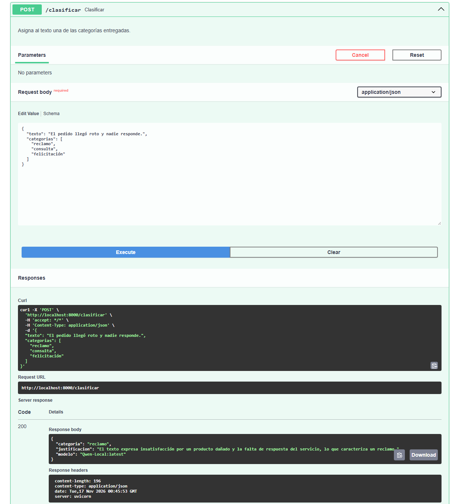

# LLM Text API, explicada en simple

Esta guía es para quien quiera entender el proyecto sin saber programar. Si buscas el detalle técnico, está en el [README](README.md).

## Qué es

Es un programa que lee textos y hace tres tareas por ti:

1. **Resumir:** le das un texto largo y te devuelve lo esencial en pocas oraciones.
2. **Clasificar:** le das un texto y una lista de categorías, y te dice a cuál pertenece y por qué.
3. **Extraer datos:** le dices qué datos buscas (un nombre, una fecha, un teléfono) y los saca del texto.

Para leer y entender los textos usa un modelo de lenguaje, el mismo tipo de tecnología que hay detrás de los asistentes de chat. La diferencia es que aquí el modelo está instalado en el propio computador.

## Para qué sirve

Para ahorrar el trabajo de leer y ordenar textos a mano. Algunos ejemplos:

| Situación | Lo que hace el programa |
|-----------|-------------------------|
| Llegan cientos de correos de clientes | Marca cada uno como reclamo, consulta o felicitación |
| Hay que revisar un informe de 10 páginas | Entrega un resumen de 3 oraciones |
| Los clientes piden reuniones por mensaje | Saca el nombre, la fecha y el teléfono de cada mensaje |

## Un ejemplo real

Al programa se le entregó este mensaje, con tres categorías posibles (reclamo, consulta, felicitación):

> El pedido llegó roto y nadie responde.

Y respondió:

> **Categoría:** reclamo
> **Justificación:** El texto expresa insatisfacción por un producto dañado y la falta de respuesta del servicio, lo que caracteriza un reclamo.

Con este otro mensaje se le pidió el nombre, la fecha y el teléfono:

> Hola, soy Ana Rojas y necesito una reunión el 3 de diciembre.

Y respondió: nombre **Ana Rojas**, fecha **3 de diciembre**, teléfono **no aparece**. Ese último punto importa: cuando un dato no está en el texto, el programa lo dice en vez de inventarlo.

## Por qué está hecho así

- **Privacidad:** el modelo corre en el mismo computador, así que los textos no se envían a ninguna empresa externa. Sirve para trabajar con información de clientes o documentos internos.
- **Sin costo por uso:** al no depender de un servicio pagado, da lo mismo procesar diez textos que diez mil.
- **Respuestas ordenadas:** el programa siempre responde con la misma estructura (por ejemplo, "categoría" y "justificación"). Eso permite conectar el resultado con una planilla o con otro sistema, sin que una persona tenga que copiar y pegar.

## Cómo funciona

Piensa en una ventanilla de atención:

1. **Tú entregas el pedido.** Por ejemplo: "clasifica este texto en una de estas categorías".
2. **La ventanilla revisa que el pedido esté completo.** Si falta el texto o las categorías, lo rechaza de inmediato y explica qué falta.
3. **La ventanilla le pasa el trabajo al modelo de lenguaje,** con instrucciones precisas sobre qué hacer y en qué formato responder.
4. **La ventanilla revisa la respuesta antes de entregarla.** Si el modelo contesta algo que no corresponde, por ejemplo una categoría que no estaba en la lista, no la deja pasar.

Ese programa que hace de ventanilla es lo que en informática se llama una **API**: un punto de atención al que otros programas pueden hacerle pedidos.

## Cómo se usa

El programa incluye una página web de prueba. Ahí eliges la tarea, pegas el texto, aprietas "Execute" y ves la respuesta. No hace falta escribir código.

En un uso real, esa misma ventanilla la consultaría otro sistema de forma automática: por ejemplo, el buzón de correos de una empresa, cada vez que llega un mensaje nuevo.

## Cómo se construyó

- **Python y FastAPI** para el programa que recibe los pedidos y valida que estén correctos.
- **Ollama** para ejecutar el modelo de lenguaje en el computador.
- **Docker** para empaquetar todo, de modo que funcione igual en cualquier equipo.
- **Pruebas automáticas** que revisan el programa cada vez que se cambia algo, para detectar errores antes de publicarlo.

## Qué muestra este proyecto

- Aplicar inteligencia artificial a un problema concreto de oficina: leer, ordenar y resumir texto.
- Construir un servicio que otros sistemas pueden usar, no solo un experimento suelto.
- Cuidar la calidad: validación de datos, manejo de errores y pruebas automáticas.
- Documentar el trabajo para que otra persona pueda ejecutarlo y entenderlo.

## Autor

Cristopher Valdovinos · [GitHub](https://github.com/Cristopher-Valdovinos) · [LinkedIn](https://linkedin.com/in/cristopher-valdovinos)
