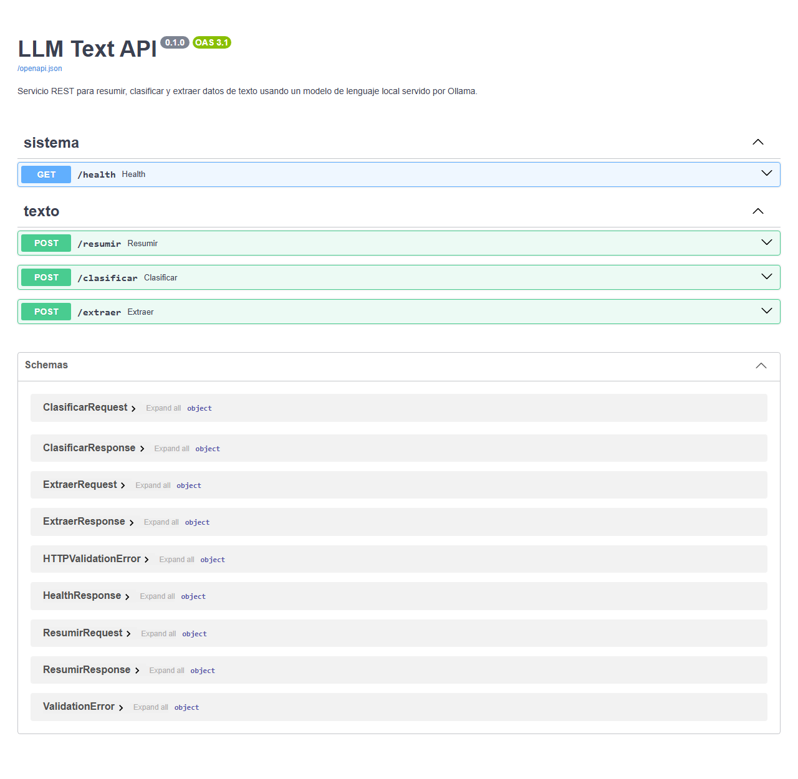

# LLM Text API

API REST para **resumir, clasificar y extraer datos de texto** usando un modelo de lenguaje local servido por [Ollama](https://ollama.com). Todo corre en tu propio equipo: los textos no salen a servicios externos.

Construida con FastAPI, con salida estructurada (JSON Schema), manejo de errores, pruebas automáticas y Docker.

## Endpoints

| Método | Ruta          | Qué hace                                                        |
|--------|---------------|-----------------------------------------------------------------|
| GET    | `/health`     | Estado de la API, conexión con Ollama y disponibilidad del modelo |
| POST   | `/resumir`    | Resume un texto en un máximo de N oraciones                     |
| POST   | `/clasificar` | Asigna al texto una categoría de una lista que tú defines       |
| POST   | `/extraer`    | Extrae los campos que pidas; devuelve `null` si un dato no está |

Documentación interactiva (Swagger): `http://localhost:8000/docs`



## Requisitos

- [Ollama](https://ollama.com) corriendo, con al menos un modelo descargado (`ollama pull llama3.2`)
- Python 3.11 o superior, o Docker

## Cómo ejecutarla

### Opción 1: Docker

```bash
cp .env.example .env        # ajusta OLLAMA_MODEL al nombre que muestra `ollama list`
docker compose up --build
```

Dentro del contenedor, `OLLAMA_BASE_URL` debe ser `http://host.docker.internal:11434` (es el valor por defecto de `docker-compose.yml`).

### Opción 2: Python local

```bash
python -m venv .venv
source .venv/bin/activate   # Windows: .venv\Scripts\activate
pip install -r requirements.txt
cp .env.example .env
uvicorn app.main:app --reload
```

## Configuración

| Variable          | Valor por defecto        | Descripción                                   |
|-------------------|--------------------------|-----------------------------------------------|
| `OLLAMA_BASE_URL` | `http://localhost:11434` | URL del servidor Ollama                       |
| `OLLAMA_MODEL`    | `llama3.2`               | Modelo a usar, tal como aparece en `ollama list` |
| `OLLAMA_TIMEOUT`  | `120`                    | Segundos máximos de espera por respuesta      |

## Ejemplos

Respuestas reales, obtenidas con un modelo Qwen local (`Qwen-Local:latest` en Ollama). Con otro modelo el texto puede variar.

**Resumir**

```bash
curl -X POST http://localhost:8000/resumir \
  -H "Content-Type: application/json" \
  -d '{"texto": "FastAPI es un framework web moderno para construir APIs con Python. Usa las anotaciones de tipo del lenguaje para validar los datos de entrada, genera documentación interactiva de forma automática y soporta código asíncrono, lo que le permite atender muchas peticiones a la vez. Por eso se usa cada vez más para exponer modelos de inteligencia artificial como servicios.", "max_oraciones": 2}'
```

```json
{
  "resumen": "FastAPI es un framework moderno de Python para crear APIs que valida datos, genera documentación automática y maneja peticiones asíncronas de forma eficiente. Por estas características, se utiliza cada vez más para exponer modelos de inteligencia artificial como servicios.",
  "modelo": "Qwen-Local:latest"
}
```

**Clasificar**

```bash
curl -X POST http://localhost:8000/clasificar \
  -H "Content-Type: application/json" \
  -d '{"texto": "El pedido llegó roto y nadie responde.", "categorias": ["reclamo", "consulta", "felicitación"]}'
```

```json
{
  "categoria": "reclamo",
  "justificacion": "El texto expresa insatisfacción por un producto dañado y la falta de respuesta del servicio, lo que caracteriza un reclamo.",
  "modelo": "Qwen-Local:latest"
}
```

**Extraer**

```bash
curl -X POST http://localhost:8000/extraer \
  -H "Content-Type: application/json" \
  -d '{"texto": "Hola, soy Ana Rojas y necesito una reunión el 3 de diciembre.", "campos": ["nombre", "fecha", "telefono"]}'
```

```json
{ "datos": { "nombre": "Ana Rojas", "fecha": "3 de diciembre", "telefono": null }, "modelo": "Qwen-Local:latest" }
```

## Errores

| Código | Cuándo ocurre                                              |
|--------|------------------------------------------------------------|
| 422    | La entrada no es válida (texto vacío, menos de 2 categorías, etc.) |
| 502    | Ollama respondió con error, no tiene el modelo o devolvió una salida inválida |
| 503    | No se pudo conectar con Ollama                             |
| 504    | El modelo tardó más que `OLLAMA_TIMEOUT`                   |

## Pruebas

Las pruebas simulan a Ollama, así que no necesitan GPU ni modelo descargado:

```bash
pip install -r requirements-dev.txt
pytest
```

## Estructura

```
app/
  main.py            # endpoints y manejo de errores
  ollama_client.py   # cliente HTTP asíncrono para Ollama
  schemas.py         # validación de entradas y salidas
  config.py          # configuración por variables de entorno
tests/
  test_api.py
Dockerfile
docker-compose.yml
```

## Decisiones de diseño

- **Salida estructurada:** `/clasificar` y `/extraer` envían un JSON Schema a Ollama, que restringe la respuesta del modelo a ese formato. Además, la API valida el resultado antes de devolverlo.
- **Cliente inyectado:** el cliente de Ollama se entrega como dependencia de FastAPI, lo que permite reemplazarlo por uno simulado en las pruebas.
- **Errores claros:** los fallos de Ollama se traducen a códigos HTTP específicos en vez de un error 500 genérico.

## Autor

Cristopher Valdovinos · [GitHub](https://github.com/Cristopher-Valdovinos) · [LinkedIn](https://linkedin.com/in/cristopher-valdovinos)

## Licencia

MIT (ver [LICENSE](../LICENSE))
