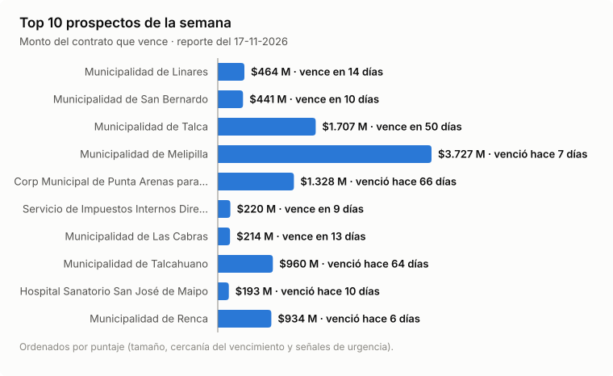

# Public Buyer Radar, explicado en simple

Esta guía es para quien quiera entender el proyecto sin saber programar. Si buscas el detalle técnico, está en el [README](README.md).

## Qué es

Un radar de oportunidades de venta al Estado. Revisa todas las compras públicas de Chile y avisa qué hospitales, municipios o servicios públicos están por volver a contratar un servicio. Así, un proveedor puede prepararse antes de que salga la licitación, en vez de enterarse cuando ya está publicada.

## Para qué sirve

El Estado chileno compra miles de millones de pesos al mes en servicios como aseo o recolección de basura. Esos contratos duran un tiempo fijo, por ejemplo 12, 24 o 72 meses, y cuando terminan el organismo tiene que volver a contratar.

Una empresa que sabe con anticipación que eso va a pasar tiene ventaja: puede estudiar al cliente, conocer a la competencia y preparar una buena oferta.

## Un ejemplo real

Con los datos hasta octubre de 2026, el reporte ponía en primer lugar a:

> **Universidad del Bío-Bío** — contrato de aseo por $1.859 millones. **Vence en 18 días.** El organismo ya hizo una compra de emergencia en los últimos meses.

Para una empresa de aseo, esa línea dice a quién llamar, cuánto vale la oportunidad y que el momento es ahora.

¿Qué pasó después? Al agregar los datos de noviembre apareció que la universidad adjudicó un **nuevo contrato de aseo el 11 de noviembre, por $3.684 millones, a otro proveedor**. La oportunidad era real, y quien llegó a tiempo se la llevó.

Puedes ver [el reporte actualizado](docs/example_report.md), con las 25 mejores oportunidades que siguen abiertas.

## Cómo funciona

1. **Recolecta.** Cada mes, ChileCompra publica todas las órdenes de compra del Estado (casi 800 MB por mes). El sistema las descarga y se queda solo con las de limpieza.
2. **Arma los contratos.** Junta las órdenes que pertenecen al mismo contrato y calcula cuándo vence cada uno.
3. **Lee con IA.** A veces la duración no está en un campo ordenado, sino escrita en texto: "servicio de aseo 2026-2028" o "por 72 meses". Un modelo de inteligencia artificial que corre en el mismo computador lee ese texto y extrae la duración. Debe citar la frase exacta de donde la sacó; si no puede, la respuesta se descarta.
4. **Prioriza.** Cada oportunidad recibe un puntaje de 0 a 100 según su tamaño, qué tan pronto vence y si hay señales de urgencia.
5. **Descarta lo que ya se renovó.** Si el organismo ya firmó un contrato nuevo, la oportunidad se saca de la lista. Este filtro eliminó casi la mitad de los candidatos.

Todo esto ocurre solo: cada lunes en la mañana, el computador descarga los datos nuevos y deja listo el reporte de la semana, sin que nadie tenga que hacer nada.

## ¿Funciona? Lo medimos

Un caso que sale bien puede ser suerte. Por eso se hizo una prueba más exigente: se "volvió al pasado" 19 veces (el primer día de cada mes, de enero de 2025 a julio de 2026). En cada fecha se armó la lista **solo con lo que se sabía ese día**, y después se revisó qué pasó en realidad.

- **55%** de los organismos de la lista volvió a contratar el servicio dentro de los 4 meses siguientes.
- Si se eligieran organismos **al azar**, solo el **31%** lo habría hecho.
- O sea, la lista es **1,8 veces mejor que elegir al azar**. Cuando el contrato está por vencer (y no vencido hace tiempo), sube a **61%**.

El sistema no es perfecto: todavía se le escapan muchas renovaciones, porque hay contratos cuya fecha de término no aparece en los datos. Pero cuando dice "llama a este organismo", acierta más de la mitad de las veces.

## Por qué está hecho así

- **Datos reales y públicos:** todo viene de los datos abiertos de ChileCompra. No hay datos inventados.
- **La IA se usa solo donde hace falta:** reglas simples resuelven la mayoría de los casos. La IA solo lee los textos que una regla no puede entender.
- **Sin inventar:** si la IA no encuentra la información, responde "no sé". Una fecha inventada podría hacer perder tiempo a un vendedor.
- **Privado:** el modelo de IA corre en el computador, no en un servicio externo.

## Qué muestra este proyecto

- Cómo convertir datos públicos en **inteligencia comercial**.
- Manejo de **grandes volúmenes de datos** (más de 2 millones de filas por mes).
- Uso **responsable** de la IA, con evidencia y sin inventar.
- Pensamiento de negocio: el resultado no es un gráfico, es una **lista de clientes a quienes llamar**.

## Autor

Cristopher Valdovinos · [LinkedIn](https://linkedin.com/in/cristopher-valdovinos)
